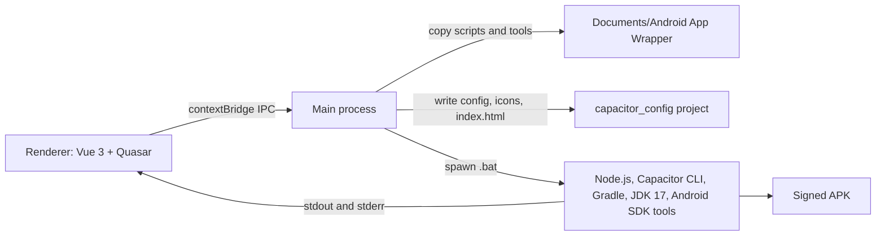

# App Website Wrapper

A Windows app that turns a website, or a folder of HTML, CSS and JavaScript, into an Android app. You choose a name, an app ID, an icon and the target SDK, and it builds the APK. It can also create a signing key and sign the release APK, so the output is ready for a store.

[Get it from the Microsoft Store](https://apps.microsoft.com/detail/9phk8k3xgzhn)

Built with Electron, Vue 3, Quasar, Capacitor and xterm.js. Written in December 2023 and January 2024, and sold on the Microsoft Store under the publisher name VitalVictor.

## What it does

- **Wraps a website or a local project.** For a URL, it writes a small `index.html` that shows the site full screen and resizes with the device. For a local project, it points Capacitor's `webDir` at your folder.
- **Configures the Android project.** It writes `capacitor.config.json` (app ID and name) and `variables.gradle` (minimum SDK 22, plus the target SDK you pick), and generates the launcher icons and splash screens from your image with `@capacitor/assets`.
- **Builds the APK.** It runs `npx cap sync` and Gradle in child processes, and streams their output into a terminal pane (xterm.js). You can type into the running process or stop it.
- **Creates a signing key.** It runs `keytool` with the name, alias and validity you enter.
- **Signs the release.** It runs `zipalign`, then `apksigner sign` and `apksigner verify`, and writes `my-app-release.apk` to the folder you choose.
- **Opens the generated files.** One click opens `AndroidManifest.xml` or the Capacitor project folder, for changes the UI doesn't cover.

## How it works



1. On first run, the main process copies the build scripts and tool folders from `public/` into `Documents/Android App Wrapper`, so builds run from a writable folder.
2. Each build step is a batch script (`app_clean_wrap_apk.bat`, `app_wrap_apk.bat`, `app_test_apk.bat`) that puts the bundled Node.js, JDK and Android command-line tools on `PATH` for that process only. Nothing is installed system-wide.
3. The main process starts the script with `spawn`, forwards its output to the renderer, and accepts input or a kill request over IPC.
4. Signing runs as two more scripts, `keysign_creation.bat` and `keysign_signing.bat`.

The renderer runs with `contextIsolation` on and reaches the main process only through the IPC calls in `src-electron/electron-preload.js`.

## Project layout

| Path | Contents |
| --- | --- |
| `src-electron/electron-main.js` | Window, IPC handlers, config writers, build and signing scripts |
| `src-electron/electron-preload.js` | The API exposed to the renderer |
| `src/pages/IndexPage.vue` | The build form and the terminal pane |
| `src/components/ProductionBase.vue` | Production mode: pick the unsigned APK and key, then sign |
| `src/components/CreateKeyToSign.vue` | Signing key creation |
| `public/*.bat` | Build and signing scripts copied to the user's Documents folder |
| `public/node-v20.10.0-win-x64` | The Node.js runtime bundled with the app |

## Building it yourself

The Store build ships three toolchains next to the scripts. Only Node.js is committed here, so add the other two before building:

- JDK 17, unpacked to `public/jdk-17_windows-x64_bin/jdk-17.0.9`
- Android command-line tools, unpacked to `public/commandlinetools-win-10406996_latest`

Then:

```bash
yarn
quasar dev -m electron     # run in development
quasar build -m electron   # build the AppX package
```

The app targets Windows: the build steps are batch files.

## License

No license is granted. The source is published so you can see how the app is built. It isn't licensed for reuse or redistribution.

Built by [Jeevanjot Singh Vital](https://jeevanjotsinghvital.com).
