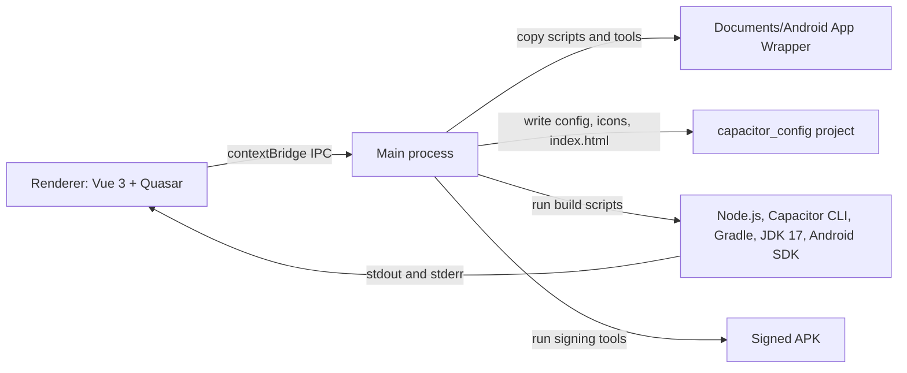

# App Website Wrapper

A Windows app that turns a website, or a folder of HTML, CSS and JavaScript, into an Android app. You choose a name, an app ID, an icon and the target SDK, and it builds the APK. It can also create a signing key and sign the release APK, so the output is ready for a store.

[Get it from the Microsoft Store](https://apps.microsoft.com/detail/9phk8k3xgzhn)

Built with Electron, Vue 3, Quasar, Capacitor and xterm.js. Written in December 2023 and January 2024, and sold on the Microsoft Store under the publisher name VitalVictor.

## What it does

- **Wraps a website or a local project.** For a URL, it writes a small `index.html` that shows the site full screen and resizes with the device. For a local project, it points Capacitor's `webDir` at your folder.
- **Configures the Android project.** It writes `capacitor.config.json` (app ID and name) and `variables.gradle` (minimum SDK 22, plus the target SDK you pick), and generates the launcher icons and splash screens from your image with `@capacitor/assets`.
- **Builds the APK.** It runs `npx cap sync` and Gradle in child processes, and streams their output into a terminal pane (xterm.js). You can type into the running process or stop it.
- **Creates a signing key.** It runs `keytool` with the name, alias and validity you enter.
- **Signs the release.** It runs `zipalign`, then `apksigner sign` and `apksigner verify`, and writes `my-app-release.apk` to the folder you choose.
- **Opens the generated files.** One click opens `AndroidManifest.xml` or the Capacitor project folder, for changes the UI doesn't cover.

## How it works



1. On first run, the main process copies the build scripts and toolchain into `Documents/Android App Wrapper`, where the app can build APKs. Use **Install Dependencies** to refresh the bundled tools.
2. The build scripts select the bundled Node.js, JDK 17 and Android SDK for that process. They install the Capacitor project dependencies on the first build.
3. The main process forwards build output to the renderer and accepts input or a stop request over IPC.
4. Key creation and signing use the bundled `keytool.exe`, `zipalign.exe` and `apksigner.jar` with separate arguments. The app stores new keys in `Documents/Android App Wrapper/signing-keys`. Existing keys can still be selected from their original locations.

The renderer runs with `contextIsolation` on and reaches the main process only through the IPC calls in `src-electron/electron-preload.js`.

## Project layout

| Path | Contents |
| --- | --- |
| `src-electron/electron-main.js` | Window and IPC handlers for building and signing |
| `src-electron/electron-preload.js` | The API exposed to the renderer |
| `src/pages/IndexPage.vue` | The build form and the terminal pane |
| `src/components/ProductionBase.vue` | Production mode: pick the unsigned APK and key, then sign |
| `src/components/CreateKeyToSign.vue` | Signing key creation |
| `src-electron/main-process.cjs` and `signing.cjs` | Paths, validation, settings writers and signing commands |
| `public/*.bat` | Android project setup and build scripts |
| `scripts/fetch-toolchain.cjs` | Fetches and checks the Windows toolchain archives |

## Building it yourself

Build and run the desktop app on **Windows 10 or 11 x64**. Install Git and a supported Node.js LTS release (22, 24 or 26) with npm 10 or newer. The toolchain download uses the `tar.exe` included with Windows. The first build needs internet access and several GB of disk space.

From the repository root in PowerShell:

```powershell
npm ci
npm run fetch:toolchain
npm test
npm run build
```

The download script installs the current Windows x64 Node.js LTS, Temurin JDK 17 and Google's Android command-line tools under `public/toolchain/`. It checks each archive's SHA-256 before unpacking. `npm run build` runs the same script automatically and reuses the verified installations when their published checksums match.

The Windows x64 AppX is written to `dist/electron/Packaged/`. Use an appropriate signing certificate if you need to sideload the AppX. For development, run `npm run dev -- -m electron` after fetching the toolchain.

### Android SDK packages

To build and sign APKs with the desktop app, use `sdkmanager` to accept the Android SDK licenses and install Platform Tools, a platform matching the target SDK, and Build Tools. The APK form defaults to API 33. To include these packages in a desktop build, run the following before `npm run build`:

```powershell
$toolchain = (Resolve-Path .\public\toolchain).Path
$env:JAVA_HOME = Join-Path $toolchain "jdk"
$sdk = Join-Path $toolchain "android-sdk"
$sdkmanager = Join-Path $sdk "cmdline-tools\latest\bin\sdkmanager.bat"
& $sdkmanager "--sdk_root=$sdk" --licenses
& $sdkmanager "--sdk_root=$sdk" "platform-tools" "platforms;android-33" "build-tools;34.0.0"
```

For an existing desktop installation, use **Install Dependencies** and set `$toolchain` to the `Android App Wrapper\toolchain` folder in Documents before running the same SDK setup commands. Install the corresponding SDK platform if you change the target API. The first APK build also downloads the project's Capacitor dependencies and Gradle.

## License

No license is granted. The source is published so you can see how the app is built. It isn't licensed for reuse or redistribution.

Built by [Jeevanjot Singh Vital](https://jeevanjotsinghvital.com).
